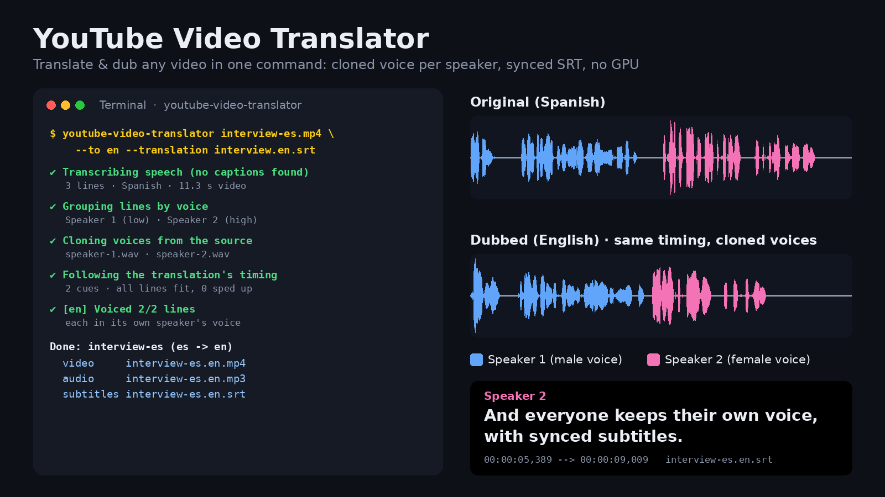
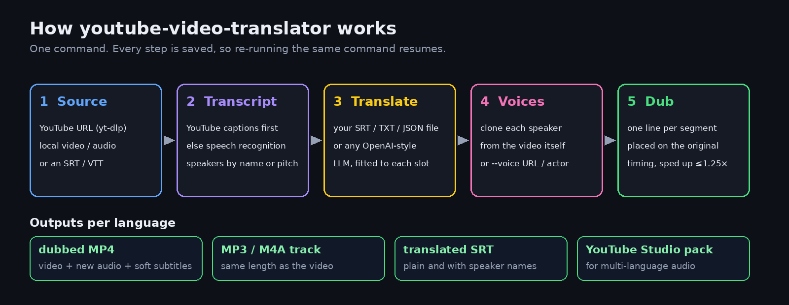

# YouTube Video Translator: translate and dub any YouTube video with cloned voices (AI video dubbing CLI)

[](https://github.com/RTY2345RR/youtube-video-translator/actions/workflows/ci.yml)
[](LICENSE)


**youtube-video-translator** is an open-source YouTube video translator and AI video dubbing command-line tool. Give it a YouTube URL or a local video, and one command gets the transcript (YouTube captions, or speech recognition when there are none), translates it (with your own translation file or any OpenAI-compatible LLM), and produces a dubbed MP4, an MP3/M4A dub track and translated SRT subtitles, with **each speaker in their own cloned voice**, timed to the original video. It needs no GPU and no local AI models: voices are cloned and rendered by the [Miragea](https://miragea.ai) voice engine.

```bash
uvx --from git+https://github.com/RTY2345RR/youtube-video-translator youtube-video-translator "https://www.youtube.com/watch?v=VIDEO_ID" --to es
```



**Hear the real output** (no edits): [English dub, MP3](examples/spanish-to-english-two-speakers/interview-es.en.mp3) · [dubbed video, MP4](examples/spanish-to-english-two-speakers/interview-es.en.mp4) · [English SRT](examples/spanish-to-english-two-speakers/interview-es.en.srt) · [original Spanish clip](examples/spanish-to-english-two-speakers/interview-es.mp4). One male and one female speaker, each keeps a distinct voice. Details in [the example](examples/spanish-to-english-two-speakers/). Play it in the browser on the [Hugging Face demo page](https://huggingface.co/spaces/miragea/youtube-video-translator).

## Contents

- [How it works](#how-it-works)
- [Features](#features)
- [Quick start](#quick-start)
- [Translate with your own file or an LLM](#translation-your-file-or-any-openai-compatible-llm)
- [Voices and voice cloning](#voices-and-voice-cloning)
- [All options](#all-options)
- [Comparison: pyvideotrans, VideoLingo and others](#comparison)
- [FAQ](#faq)
- [Troubleshooting](#troubleshooting)
- [Related projects](#related-projects)

## How it works



1. **Source**: a YouTube URL (downloaded with yt-dlp), a local video or audio file, or an SRT/VTT transcript.
2. **Transcript**: YouTube's own captions when the video has them (manual first, then automatic), otherwise speech recognition by the Miragea subtitle engine. Lines are merged into sentences, and speakers are found from names in the captions (`Anna: ...`, `[Ben]`, `>> `) or, when there are none, grouped by voice pitch.
3. **Translate**: lines are translated with a character budget that fits each speaker's original time slot, then any line that is still too long is shortened.
4. **Voices**: a clean 4-14 s sample of each speaker is cut from the video and used to clone that voice. You can override any speaker with your own clip or a saved voice.
5. **Dub**: each line is voiced, placed at its original start time and sped up (pitch kept, at most 1.25× by default) only when it would overlap the next line. The dub track is exactly as long as the video.

Every step is saved in a project folder named after the source, so **running the same command again resumes**: finished transcripts, translations and voiced lines are reused, and pending voice jobs are picked up rather than submitted again.

## Features

- **One command, YouTube URL in, dubbed video out.** `youtube-video-translator URL --to es,de,pt-BR` handles download, transcript, translation, voices and muxing.
- **Each speaker keeps their own voice.** Multi-speaker videos are split by caption names or voice pitch, and every speaker is cloned from their own lines.
- **No GPU, no model downloads.** Pure Python plus ffmpeg (bundled via `imageio-ffmpeg`), so it runs on a laptop, a CI runner or a $5 VPS.
- **Bring your own translation.** Use a human translation (SRT, VTT, TXT or JSON), or any OpenAI-compatible LLM: OpenAI, OpenRouter, DeepSeek, Groq, Together, or a local Ollama / LM Studio.
- **Timing-aware translation.** Each line gets a length budget from its time slot and the target language's speaking rate, so dubs stay in sync without chipmunk speed-ups.
- **Outputs for every use**: dubbed MP4 (original picture, new audio, soft subtitles), MP3/M4A/WAV track, translated SRT (plain and with speaker names), the source transcript as SRT, and, for YouTube sources, a folder ready for YouTube Studio > Languages (multi-language audio tracks).
- **Subtitles only mode**: `--subtitles-only` writes translated SRT subtitles with no voices (translate YouTube video subtitles to English, Spanish, and more).
- **Resumable and safe to retry**: no duplicate jobs on retry; API keys are never printed or written to disk.
- **Scriptable**: `--json` prints a machine-readable result, every error is one readable line, and the exit code is non-zero on failure.

## Quick start

**1. Install** (Python 3.10+). With [uv](https://docs.astral.sh/uv/) nothing else is needed:

```bash
uvx --from git+https://github.com/RTY2345RR/youtube-video-translator youtube-video-translator --help
# or install it as a command
pipx install git+https://github.com/RTY2345RR/youtube-video-translator
```

**2. Set the voice engine key.** Create one at [miragea.ai/workspace/api](https://miragea.ai/workspace/api), then:

```bash
export MIRAGEA_API_KEY=...            # Windows: setx MIRAGEA_API_KEY ...
```

AI agents can set it up from the integration guide: Install https://miragea.ai/skills/miragea-audio/install.md

**3. Pick a translator** (skip this when you pass `--translation FILE`):

```bash
export OPENAI_API_KEY=...                                   # OpenAI, default model gpt-4o-mini
# or any OpenAI-compatible endpoint:
export TRANSLATOR_LLM_BASE_URL=https://openrouter.ai/api/v1
export TRANSLATOR_LLM_API_KEY=...
export TRANSLATOR_LLM_MODEL=deepseek/deepseek-chat
# or a local model:
export TRANSLATOR_LLM_BASE_URL=http://localhost:11434/v1 TRANSLATOR_LLM_MODEL=qwen2.5:14b
```

**4. Translate a video:**

```bash
youtube-video-translator --check                                       # ffmpeg, yt-dlp, keys (creates no job)
youtube-video-translator "https://youtu.be/VIDEO_ID" --to es           # translate YouTube video to Spanish audio
youtube-video-translator lecture.mp4 --to en,de,fr                     # translate video to English, German, French
youtube-video-translator "https://youtu.be/VIDEO_ID" --to en --subtitles-only   # English subtitles only
```

Output (in `./translated/<video>/`):

```text
Done: interview-es  (es -> en)
  speakers: Marco, Lucia   transcript: caption-file
  source subtitles: translated/interview-es-73042e/interview-es.source.srt
  [en]
    video     translated/interview-es-73042e/interview-es.en.mp4
    audio     translated/interview-es-73042e/interview-es.en.mp3
    subtitles translated/interview-es-73042e/interview-es.en.srt
```

## Translation: your file or any OpenAI-compatible LLM

**Your own translation file** (`-t / --translation`) is used as-is, word for word:

| Format | What it contains |
| --- | --- |
| `.srt` / `.vtt` | Translated subtitles. Same number of cues as the transcript: matched in order. A different cut: the dub follows **your** cue timing. |
| `.txt` | One translated line per transcript line (blank lines ignored). |
| `.json` | `{"1": "line", "2": "line"}`, a list of strings, `[{"id": 1, "text": "..."}]`, or `{"es": {...}, "de": {...}}` for several languages. |

Tip: run `--subtitles-only` (or any run) first to get `<video>.source.srt`, translate that file, and pass it back with `--translation`.

**An LLM** is used when no file is given. Each request carries the lines, the speaker, two neighbouring lines for context, the video title, and `target_chars` / `max_chars` budgets for every line. Lines the model skips are requested again, and lines that come out too long are sent back once to be shortened. The video title is translated too (for the YouTube Studio package).

## Voices and voice cloning

By default every speaker is **cloned from the video**: the tool cuts the best 4-14 s run of each speaker's lines, uploads it to a temporary public file host (files expire after a few hours) so the voice engine can fetch it, and uses the matching transcript as the reference text.

Override any speaker with `--voice`:

```bash
--voice "Speaker 1=https://example.com/my-voice.wav|Exact words spoken in the clip."   # clone from your clip
--voice "Anna=actor:42"                                                                  # a saved voice id
--voice "*=actor:42"                                                                     # every speaker
```

Speaker names come from the captions (`Anna: Hello`) or are `Speaker 1`, `Speaker 2`... Use `--speakers 1` to force a single voice, or `--speakers 3` when you know the count. Only clone voices you have the right to use.

## All options

| Option | Default | Meaning |
| --- | --- | --- |
| `SOURCE` | | YouTube URL, local video/audio file, or SRT/VTT transcript |
| `--to` | | target languages, comma separated (`en`, `es`, `pt-BR`, `ja`...) |
| `--from` | auto | source language |
| `-t, --translation` | | your translation file (see above) |
| `--llm-base-url`, `--llm-model` | env | OpenAI-compatible endpoint and model |
| `--voice NAME=VOICE` | clone | speaker voice override, repeatable |
| `--speakers N` | auto | number of speakers when captions carry no names |
| `--captions FILE` | | use this SRT/VTT as the source transcript |
| `--no-youtube-captions` | | ignore YouTube captions, run speech recognition |
| `--subtitles-only` | | only translated SRT, no voices |
| `--audio-only` | | skip the video download and the MP4 |
| `--format` | `mp3` | dub track format: `mp3`, `m4a`, `wav` |
| `--max-speedup` | `1.25` | max speed-up for a line longer than its slot |
| `--original-volume` | `0` | mix the original audio under the dub (voice-over style), 0-1 |
| `--model` | engine default | voice model id |
| `-o, --output` | `./translated` | output folder |
| `--fresh` | | start over instead of resuming |
| `--json`, `-q` | | JSON result / no progress messages |

Environment: `MIRAGEA_API_KEY`, `TRANSLATOR_LLM_BASE_URL`, `TRANSLATOR_LLM_API_KEY` (or `OPENAI_API_KEY`), `TRANSLATOR_LLM_MODEL`, `TRANSLATOR_OUTPUT_DIR`, `TRANSLATOR_CONCURRENCY` (parallel voice jobs, default 4), `YTDLP_COOKIES_FROM_BROWSER` / `YTDLP_COOKIES`, `FFMPEG_BINARY`.

## Comparison

An honest look at the popular open-source video translators. They are excellent projects with larger feature sets; this tool aims to be the shortest path from a YouTube URL to a dub in the speakers' own voices.

| | **youtube-video-translator** | pyvideotrans | VideoLingo | ThioJoe Auto-Synced-Translated-Dubs |
| --- | --- | --- | --- | --- |
| Interface | one CLI command (scriptable, `--json`) | desktop GUI + CLI | Streamlit web UI | Python scripts + config files |
| Install | `uvx` / `pipx`, ffmpeg bundled | Windows exe or source install, many deps | installer + local ASR models | pip + cloud API config files |
| GPU / local models | not needed | optional (Whisper, local TTS / cloning) | local ASR by default, GPU image available | not needed |
| YouTube URL input | yes (captions used when present) | yes | yes | no, needs an SRT first |
| Speakers | automatic, one cloned voice each by default | speaker diarization, voice per role | no automatic voice per speaker | one voice per language |
| Voice cloning | default, cloned from the video itself | via local F5-TTS / CosyVoice / GPT-SoVITS or cloud | via GPT-SoVITS / F5-TTS / CosyVoice backends | no (Azure, Google or ElevenLabs voices) |
| Translation | your file or any OpenAI-compatible LLM, length-budgeted | many engines and LLMs | OpenAI-compatible LLMs, multi-step | Google / DeepL |
| Burned-in subtitles | no (soft subtitles in MP4) | yes | yes, Netflix-style cutting | no |
| Offline use | no (cloud voice engine) | yes | partly | no |
| Licence | MIT | GPL-3.0 | Apache-2.0 | AGPL-3.0 |

Pick **pyvideotrans** for a full desktop app with offline models, **VideoLingo** for polished burned-in subtitles, and **youtube-video-translator** when you want one command, no GPU, and real per-speaker voice clones.

## FAQ

**How do I translate a YouTube video to English?**
Run `youtube-video-translator "https://youtu.be/VIDEO_ID" --to en`. You get an English-dubbed MP4, an MP3 track and English SRT subtitles. Add `--subtitles-only` if you only want the English subtitles.

**Can I translate a YouTube video to English without CC (closed captions)?**
Yes. When a video has no captions the speech is transcribed by the Miragea subtitle engine, then translated and dubbed as usual. `--no-youtube-captions` forces this even when captions exist.

**How do I translate a YouTube video to Spanish audio?**
`youtube-video-translator URL --to es`. The Spanish dub is in `<video>.es.mp3` and inside `<video>.es.mp4`. For several languages at once: `--to es,pt-BR,de,fr`.

**Is this a free, open-source AI video translator?**
The tool is MIT-licensed and free. The voices and speech recognition run on the Miragea voice engine (an API key is required), and translation uses your own file or the LLM you configure, which can be a free local model through Ollama.

**Does it keep the original speaker's voice?**
Yes. Each speaker is cloned from a sample of their own lines in the video, so a two-person interview comes back with two distinct voices that sound like the originals. Turn this off for any speaker with `--voice`.

**Do I need a GPU?**
No. Nothing runs locally except ffmpeg, so it works on any laptop, server or CI runner, including Windows, macOS and Linux.

**What is the best pyvideotrans or VideoLingo alternative for one-command dubbing?**
If you want a scriptable command instead of a GUI, no PyTorch or GPU setup, and per-speaker voice cloning by default, this tool is built for that. See the [comparison](#comparison) for where the others are stronger.

**Can I upload the dub to YouTube as a second audio track?**
Yes. For YouTube sources a `youtube-upload/` folder is written with `audio`, `captions.srt`, the translated title and step-by-step instructions for YouTube Studio > Languages. Multi-language audio is available to channels YouTube has enabled for it. For a dedicated tool see [youtube-dubbing-mcp](https://github.com/RTY2345RR/youtube-dubbing-mcp).

**How do I use my own translation instead of machine translation?**
Pass `--translation my.es.srt` (or TXT / JSON). Your lines are used exactly; the dub follows your subtitle timing when the cut differs from the transcript.

**Which LLMs work for translation?**
Any endpoint that implements the OpenAI `/chat/completions` API: OpenAI, OpenRouter, DeepSeek, Groq, Together, Mistral, Azure-compatible proxies, Ollama, LM Studio, vLLM.

**What languages are supported?**
Any language your translator handles and the voice engine speaks; common ones include English, Spanish, Portuguese, French, German, Italian, Japanese, Korean, Chinese, Hindi, Arabic and Russian. Speaking-rate budgets are tuned for 35+ languages.

**What happens if it stops halfway?**
Run the same command again. It resumes from the saved project, reuses every finished line and never submits the same voice job twice.

## Troubleshooting

| Problem | Fix |
| --- | --- |
| `MIRAGEA_API_KEY is not set` | `export MIRAGEA_API_KEY=...` (key from [miragea.ai/workspace/api](https://miragea.ai/workspace/api)), or use `--subtitles-only`. |
| `No translation for xx` | Pass `--translation FILE`, or set `OPENAI_API_KEY` / `TRANSLATOR_LLM_BASE_URL`. |
| YouTube says "Sign in to confirm you're not a bot" | `export YTDLP_COOKIES_FROM_BROWSER=chrome` (or firefox, edge, safari), or `YTDLP_COOKIES=cookies.txt`; or download the video and pass the file. |
| Wrong speakers | Use `--speakers N`, or pass `--captions file.srt` with names (`Anna: ...`). |
| A voice sounds wrong | Give that speaker a cleaner clip: `--voice "Speaker 2=https://...wav|exact words"`, then re-run (only that speaker's lines are redone). |
| Some lines sound rushed | Shorten them in your translation file, or allow more with `--max-speedup 1.4`. |
| `wait_timeout` | Voice jobs keep running in the cloud. Run the same command again to collect them. |
| `ffmpeg was not found` | Reinstall (it ships `imageio-ffmpeg`), install ffmpeg, or set `FFMPEG_BINARY`. |

## Related projects

- [youtube-dubbing-mcp](https://github.com/RTY2345RR/youtube-dubbing-mcp): the same dubbing engine as an MCP server for Claude, Cursor and Codex (the agent does the translation).
- [miragea-voice-mcp](https://github.com/RTY2345RR/miragea-voice-mcp) (PyPI `tts-mcp-server`): text-to-speech, voiceover and captions MCP server.
- [miragea-agent-skills](https://github.com/RTY2345RR/miragea-agent-skills): Agent Skills for voiceover and YouTube dubbing.

## Development

```bash
git clone https://github.com/RTY2345RR/youtube-video-translator && cd youtube-video-translator
pip install -e ".[dev]" && pytest          # all tests use a mocked voice engine and LLM
```

Credits: demo voices are derived from the CMU ARCTIC databases, see [CREDITS.md](CREDITS.md). Licence: [MIT](LICENSE). Machine-readable summary: [llms.txt](llms.txt).
